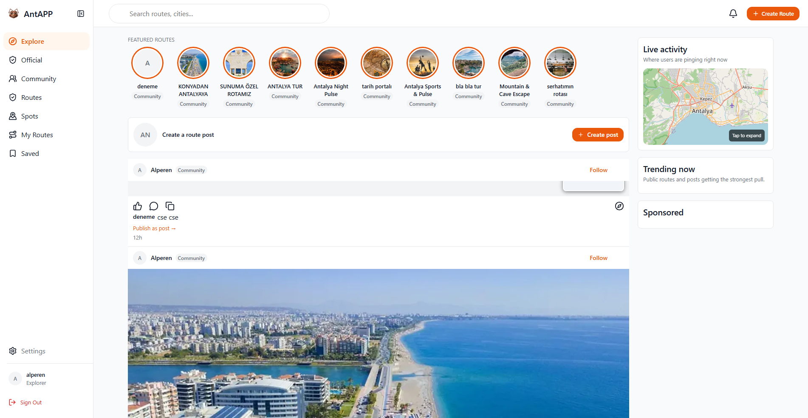
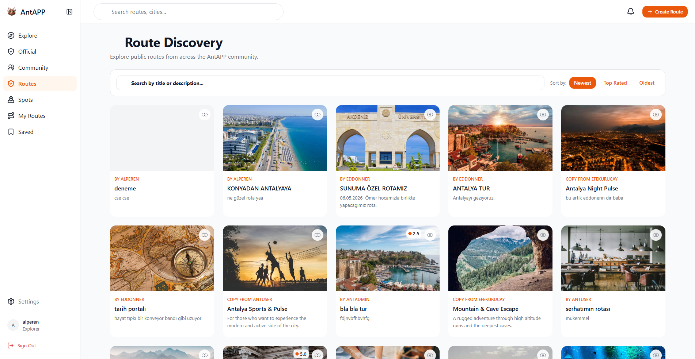
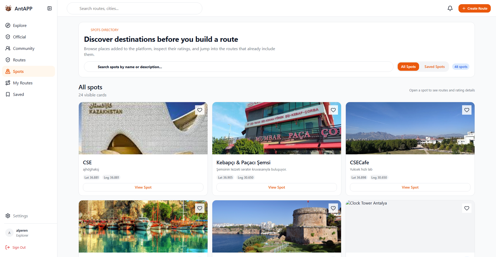
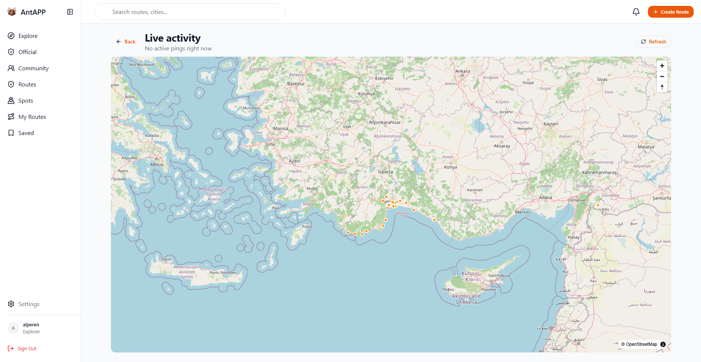

# AntAPP

AntAPP is a production-deployed route planning and social discovery platform for exploring Antalya through community routes, curated spots, live map activity, ratings, collections, and route sharing.

Built as a 4-person software engineering project, AntAPP combines a modern cross-platform frontend with a clean, scalable .NET backend. It is not just a UI prototype: it includes authentication, role-based access, route and spot management, social posts, heatmap activity, caching, CI/CD, and a real deployment pipeline.

**Live demo:** [antapp.fun](https://antapp.fun/)

## Product Preview

### Social route feed



### Route discovery



### Spot directory



### Live activity map



## Why AntAPP

Travel planning usually happens across too many tabs: maps, saved lists, recommendations, ratings, notes, and social posts. AntAPP brings those pieces into one experience.

Users can discover public routes, inspect the spots inside them, save favorite places, fork routes into their own collections, and see where the community is active on the map. The product is designed around real exploration workflows, not static travel content.

## Highlights

- Public and community route discovery with search, sorting, ratings, thumbnails, and map previews
- Interactive route detail pages with stops, ratings, save-to-collection, route forking, and navigation entry points
- Spot directory with location metadata, favorites, ratings, and linked routes
- Social feed for route posts, comments, reactions, sharing, and public profiles
- Live activity heatmap powered by location pings and map tile aggregation
- Role-based web areas for users, business users, and admins
- Hybrid httpOnly cookie plus JWT authentication with refresh token rotation
- Shared design system for web and mobile using Tamagui and Solito
- Production deployment through Docker, Coolify, Traefik, and Azure DevOps CI/CD

## Tech Stack

| Layer | Technology |
|---|---|
| Backend | .NET 8, ASP.NET Core Web API, Clean Architecture, CQRS, MediatR |
| Data | EF Core, ASP.NET Identity, PostgreSQL/PostGIS-ready production setup, in-memory development mode |
| Cache and activity | Valkey, output caching, live heatmap aggregation |
| Web | Next.js 16 App Router, React 19, TypeScript, Tamagui, MapLibre |
| Mobile | Expo SDK 55, React Native 0.83, Expo Router |
| Shared packages | `@antapp/ui` for UI, `@antapp/app` for platform-agnostic screens |
| Deployment | Docker, Coolify, Traefik, Azure DevOps Pipelines |

## Architecture

```text
AntAPP
|-- backend/Ant
|   |-- Ant.Core             # Domain entities and enums
|   |-- Ant.Application      # CQRS features, DTOs, interfaces
|   |-- Ant.Infrastructure   # EF Core, Identity, cache, external services
|   `-- Ant.WebApi           # Controllers, middleware, API configuration
|-- web                      # Next.js web app
|-- mobile                   # Expo mobile app
`-- packages
    |-- ui                   # Shared Tamagui component system
    `-- app                  # Shared Solito screens and app logic
```

## Core Domains

- **Routes:** create, publish, fork, rate, save, search, and organize routes.
- **Spots:** browse destinations, inspect metadata, favorite places, and connect spots to routes.
- **Community:** route posts, comments, reactions, shares, public profiles, and follows.
- **Collections:** save routes into personal collections for later planning.
- **Heatmap:** track active exploration areas through Valkey-backed location pings.
- **Admin and business workflows:** manage platform content and business-owned spots/routes.

## Getting Started

### Prerequisites

- .NET 8 SDK
- Node.js and npm
- Docker, optional but recommended for Valkey

### Clone and install

```bash
git clone <repository-url>
cd AntAPP
npm install
```

### Environment files

```bash
cp web/.env.example web/.env.local
cp mobile/.env.example mobile/.env.local
```

Default local API values:

```bash
NEXT_PUBLIC_API_URL=http://localhost:5000/api
EXPO_PUBLIC_API_URL=http://<local-ip>:5000/api
```

### Run the backend

```bash
cd backend
dotnet run --project Ant/Ant.WebApi
```

### Run the web app

```bash
npm run web
```

### Run the mobile app

```bash
npm run mobile
```

## Build Checks

```bash
npm run build --workspace=web
cd backend
dotnet build Ant.sln
```

## Deployment

The production version is deployed at [antapp.fun](https://antapp.fun/) with:

- `antapp.fun` for the Next.js web application
- `api.antapp.fun` for the ASP.NET Core backend API
- Docker images for web and backend services
- Valkey for cache and heatmap activity
- Coolify and Traefik for container orchestration, routing, and HTTPS
- Azure DevOps pipeline for build and deployment automation

## Project Scope

AntAPP was developed by a 4-person team as a full software engineering project. The goal was to deliver a real, deployed, maintainable product: not only screens, but also authentication, backend architecture, API boundaries, shared frontend packages, map interaction, production deployment, and documentation.

## Repository Notes

- Frontend UI conventions live in [docs/FRONTEND.md](docs/FRONTEND.md).
- Deployment notes live in [docs/deployment_guide.md](docs/deployment_guide.md).
- API notes for collections live in [docs/COLLECTIONS_API.md](docs/COLLECTIONS_API.md).
